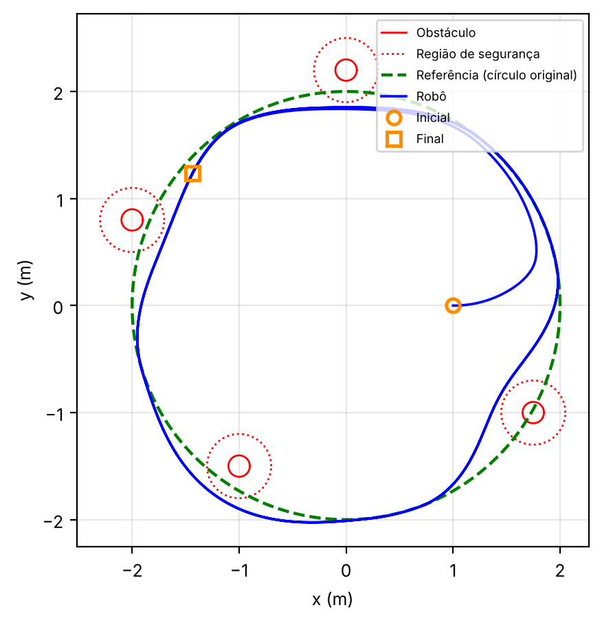
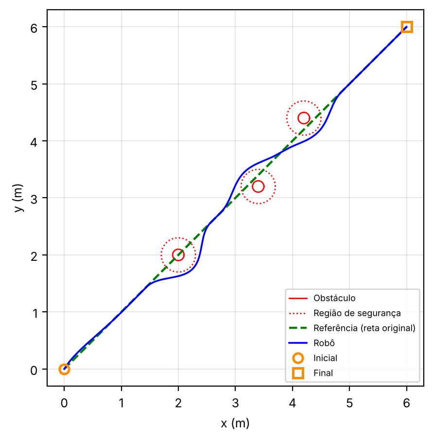
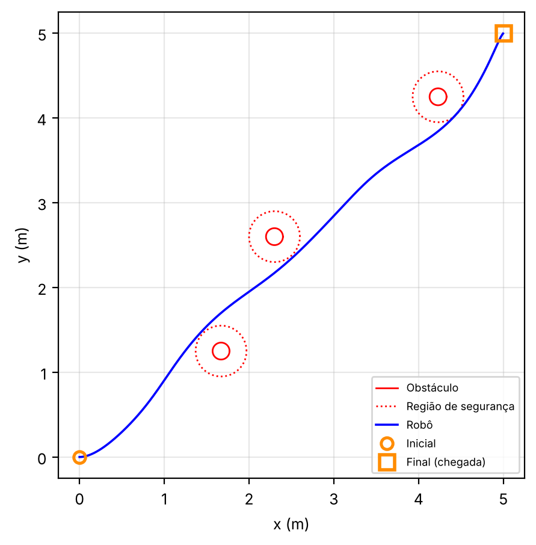

# Modelagem de Robôs Móveis e Sistema de Segurança com Funções Barreira de Controle

Estudo, simulação e código de um **robô móvel diferencial** que segue uma referência e **desvia de obstáculos** com segurança garantida por **funções barreira de controle (CBF)**, combinadas a uma **função de Lyapunov de controle (CLF)** em um **programa quadrático (QP)**.

Três cenários são tratados: **trajetória circular**, **linha reta** entre dois pontos e **ponto de chegada** (sem trajetória definida, com orientação final).

| Círculo | Reta | Ponto de chegada |
|---|---|---|
|  |  |  |

*(Simulação em Python com as mesmas configurações dos modelos Simulink; as capturas do próprio Simulink estão em [`figures/simulink`](figures/simulink).)*

## Índice

### Estudo ([`docs/`](docs))

| # | Documento | Conteúdo |
|---|---|---|
| 1 | [Modelagem](docs/01-modelagem.md) | monociclo, forma afim, ponto de controle, erros de pose |
| 2 | [CLF e seguimento](docs/02-clf.md) | função de Lyapunov, derivadas de Lie, restrição com folga |
| 3 | [CBF e segurança](docs/03-cbf.md) | conjunto seguro, barreira de obstáculo, o que a garantia cobre |
| 4 | [QP e solver de Hildreth](docs/04-qp-e-solver.md) | montagem do QP, algoritmo, efeito do `psc` |
| 5 | [Controle nominal](docs/05-controle-nominal.md) | Kanayama, controlador polar, giro no lugar |
| 6 | [Simetria e escolha do lado](docs/06-simetria-e-escolha-do-lado.md) | impasse, estratégias testadas |
| 7 | [Referência deformada](docs/07-referencia-deformada.md) | regra do menor desvio; círculo, reta e ponto |
| 8 | [Cenários](docs/08-cenarios.md) | definição, parâmetros e arquivos de cada cenário |
| 9 | [Código MATLAB](docs/09-codigo-matlab.md) | anatomia do bloco, interface, erros comuns, **patches** |
| 10 | [Simulação em Python](docs/10-simulacao-python.md) | réplica, validação, como usar |
| 11 | [Resultados](docs/11-resultados.md) | tabelas e figuras (Python e Simulink) |
| 12 | [Histórico de melhorias](docs/12-historico-de-melhorias.md) | problemas, causas, modificações, lições |
| 13 | [Guia de parâmetros](docs/13-guia-de-parametros.md) | efeito de cada parâmetro, sintomas e ajustes |
| 14 | [Limitações e próximos passos](docs/14-limitacoes-e-proximos-passos.md) | |
| — | [Referências](docs/referencias.md) · [BibTeX](docs/referencias.bib) · [Relatório final (PDF, ABNT)](docs/relatorio/Relatorio_Final_ABNT.pdf) | |

### Código

| Pasta | Conteúdo |
|---|---|
| [`matlab/`](matlab) | modelos Simulink, arquivos `INIT`, `QPhild.m`, derivação simbólica, cópias legíveis dos blocos |
| [`python/`](python) | pacote `cbf_robot` (réplica da lógica), exemplos e testes |
| [`figures/`](figures) · [`results/`](results) | figuras e métricas geradas |

## Estrutura do repositório

```
.
├── README.md
├── LICENSE · CITATION.cff · .gitignore
├── docs/                      # estudo (01 a 14), referências e relatório em PDF
│   └── relatorio/Relatorio_Final_ABNT.pdf
├── matlab/
│   ├── setup.m
│   ├── common/                # QPhild.m, LIE_DIF_CBF.m
│   ├── circular/              # INIT + .slx + fcn_circular_bloco.m
│   ├── reta/                  # INIT + .slx + fcn_reta_bloco.m
│   └── ponto/                 # INIT + .slx + fcn_ponto_bloco.m (+ variantes/)
├── python/
│   ├── cbf_robot/             # qp, controller, nominal, references, scenarios, metrics
│   ├── examples/              # run_*.py, make_figures.py
│   └── tests/
├── figures/{python,simulink}/
└── results/metricas.json
```

## Início rápido

**MATLAB/Simulink** (detalhes em [`matlab/README.md`](matlab/README.md)):

```matlab
cd matlab; setup            % adiciona common/ ao caminho
cd circular                 % ou reta, ponto
bdclose all
% abra INIT_DIF_CBF_*.m no editor e clique em Run   (sample time do bloco = 0,01 s)
```

**Python** (detalhes em [`python/README.md`](python/README.md)):

```bash
cd python && pip install -r requirements.txt
python examples/run_circular.py
python examples/make_figures.py
pytest -q tests
```

## Principais conclusões

- O QP deve minimizar $\|u - u_{nom}\|^2$, e não $\|u\|^2$; do contrário, o robô aceita erro permanente de rastreamento.
- O peso da folga da CLF ($psc$) muito grande ($10^4$) torna o solver de Hildreth instável (oscilações de $w$): 520 saltos bruscos contra 12 com $psc = 1000$.
- Em situações simétricas, **quem decide o lado do desvio é a CBF junto com o estado do robô**; empurrar o controle nominal não foi suficiente com $r_s = 0{,}3$ m. **Deformar a referência interna** pelo lado de menor desvio torna a decisão determinística.
- No ponto de chegada, o controlador de trajetória (Kanayama) não funciona (com $v_d = 0$ o robô para ao lado do alvo); o controlador polar, com giro no lugar, chega com erro de 0,5 cm e 0,00 rad, a partir de qualquer pose inicial.

## Atenção

Os `.slx` são as versões entregues. Há três pontos de atenção, com **patches propostos** (não aplicados aos modelos) em [`docs/09-codigo-matlab.md`, seção 9.7](docs/09-codigo-matlab.md):

1. círculo: obstáculos **longe** da circunferência deformam a referência sem necessidade (falta uma guarda);
2. ponto de chegada: falta o corte de obstáculos atrás do alvo;
3. ponto de chegada: `G` e `thG` estão no bloco e repetidos no `INIT`.

Os resultados quantitativos vêm da réplica em Python; os gráficos do Simulink serviram para verificação qualitativa. Os valores de `rs` e `l` são de simulação e devem vir das dimensões do robô real.

## Autoria

**Edson Sadao Mito** — Engenharia de Informação, Centro de Engenharia, Modelagem e Ciências Sociais Aplicadas (CECS), Universidade Federal do ABC, Santo André.
Orientação: Prof. Dr. Caio Igor Gonçalves Chinelato.

## Licença

[MIT](LICENSE).
