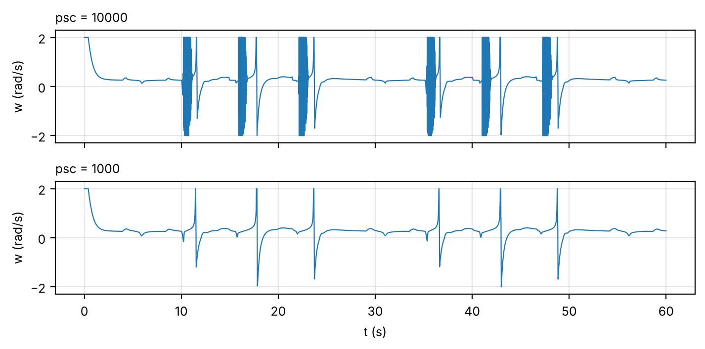

# 4. O programa quadrático e o solver de Hildreth

## 4.1 O QP a cada instante

As variáveis são $z = [v,\; w,\; \delta]^\top$:

$$
\min_{z}\;\; \tfrac12 z^\top H z + f^\top z, \qquad
H = \mathrm{diag}(1,\,1,\,psc), \qquad f = [-v_{nom},\; -w_{nom},\; 0]^\top
$$

que equivale a $\min\, \|u - u_{nom}\|^2 + psc\,\delta^2$, sujeito a:

| Restrição | Linha de $A$ | Lado direito $b$ |
|---|---|---|
| CLF (mole) | $[\,L_gV,\; -1\,]$ | $-c\,V - V_t$ |
| CBF do obstáculo $i$ | $[\,-L_g h_i,\; 0\,]$ | $\lambda\, h_i$ |
| $v \le v_{max}$, $-v \le v_{max}$ | $[1,0,0]$, $[-1,0,0]$ | $v_{max}$ |
| $w \le w_{max}$, $-w \le w_{max}$ | $[0,1,0]$, $[0,-1,0]$ | $w_{max}$ |

Leitura: **o controle mais próximo do nominal** que respeita a segurança (restrição dura) e, na medida do possível, o decaimento da CLF (restrição mole). Longe dos obstáculos, o QP devolve $u_{nom}$.

## 4.2 Método de Hildreth

Resolve $\min \tfrac12 x^\top H x + f^\top x$ sujeito a $A x \le b$ pelo **problema dual**, por subida coordenada a coordenada:

1. Solução sem restrições: $\eta = -H^{-1} f$. Se $A\eta \le b$, terminou.
2. Caso contrário, monta $P = A H^{-1} A^\top$ e $d = A H^{-1} f + b$.
3. Para cada restrição $i$, atualiza o multiplicador, projetando em $\ge 0$:
   $\lambda_i \leftarrow \max\!\big(0,\; -(P_{i,:}\lambda - P_{ii}\lambda_i + d_i)/P_{ii}\big)$
4. Repete até a mudança em $\lambda$ ficar abaixo de $10^{-7}$, ou até o limite de iterações.
5. Solução: $\eta = -H^{-1} f - H^{-1} A^\top \lambda$.

É o método descrito por Wang (2009), baseado em Hildreth (1957) (ver [referencias.md](referencias.md)). A implementação MATLAB original usava 38 iterações; o estudo adotou 200 ([`matlab/common/QPhild.m`](../matlab/common/QPhild.m)).

## 4.3 Limitações observadas

| Problema | Causa | O que foi feito |
|---|---|---|
| **Oscilação de $w$ entre ±2 rad/s** com $psc = 10000$ | $H = \mathrm{diag}(1,1,psc)$ fica mal condicionada; a subida coordenada converge devagar e a solução salta entre passos | $psc = 1000$ ou menos (veja a tabela abaixo) |
| Poucas iterações | Com várias restrições ativas, 38 iterações podem não convergir | 200 iterações |
| Restrições incompatíveis | CBFs + limites de $v, w$ | O método devolve uma aproximação; em teste, não houve violação com os cenários do estudo |

Efeito de $psc$ (círculo, 4 obstáculos, $r_s = 0{,}2$ m, viés de lado fixo, Python; arquivo [`results/metricas.json`](../results/metricas.json)):

| $psc$ | Saltos bruscos de $w$ | $w$ saturado (% do tempo) | Erro rms até o ponto móvel (m) |
|---|---|---|---|
| 10000 | **520** | 5,1 | 0,326 |
| 3000 | 8 | 1,2 | 0,325 |
| 1000 | 12 | 1,1 | 0,324 |
| 300 | 5 | 1,1 | 0,324 |
| 100 | 5 | 0,8 | 0,329 |

O erro de rastreamento praticamente não muda; o que muda é a suavidade do controle. *Saltos bruscos* = amostras em que $w$ varia mais de 1 rad/s de uma vez.

## 4.4 Onde isso está no código

| | Arquivo |
|---|---|
| MATLAB | [`matlab/common/QPhild.m`](../matlab/common/QPhild.m), chamada com `coder.extrinsic('QPhild')` no bloco |
| Python | [`python/cbf_robot/qp.py`](../python/cbf_robot/qp.py); teste em [`python/tests/test_qp.py`](../python/tests/test_qp.py) |
