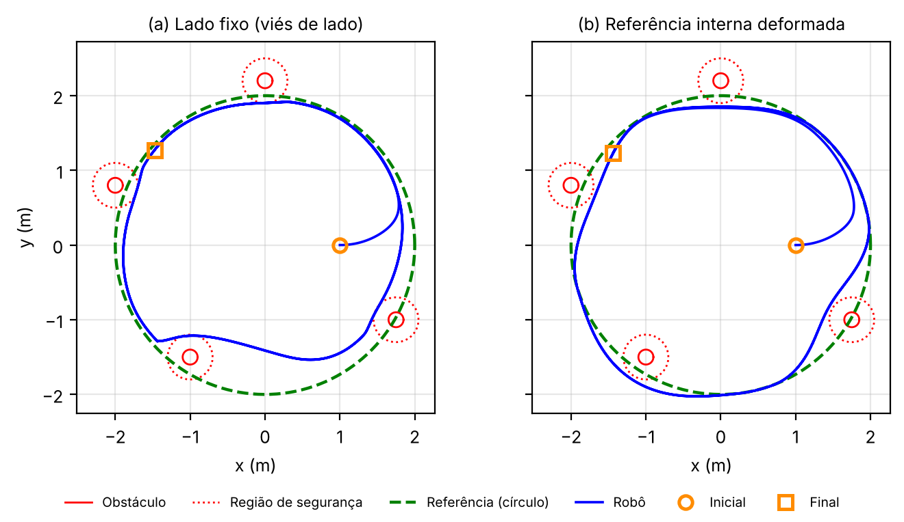
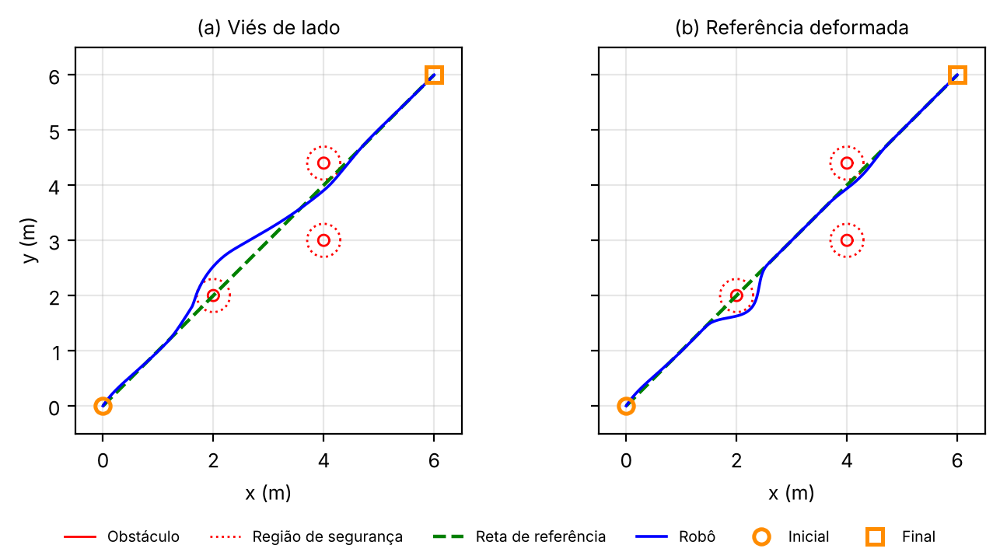
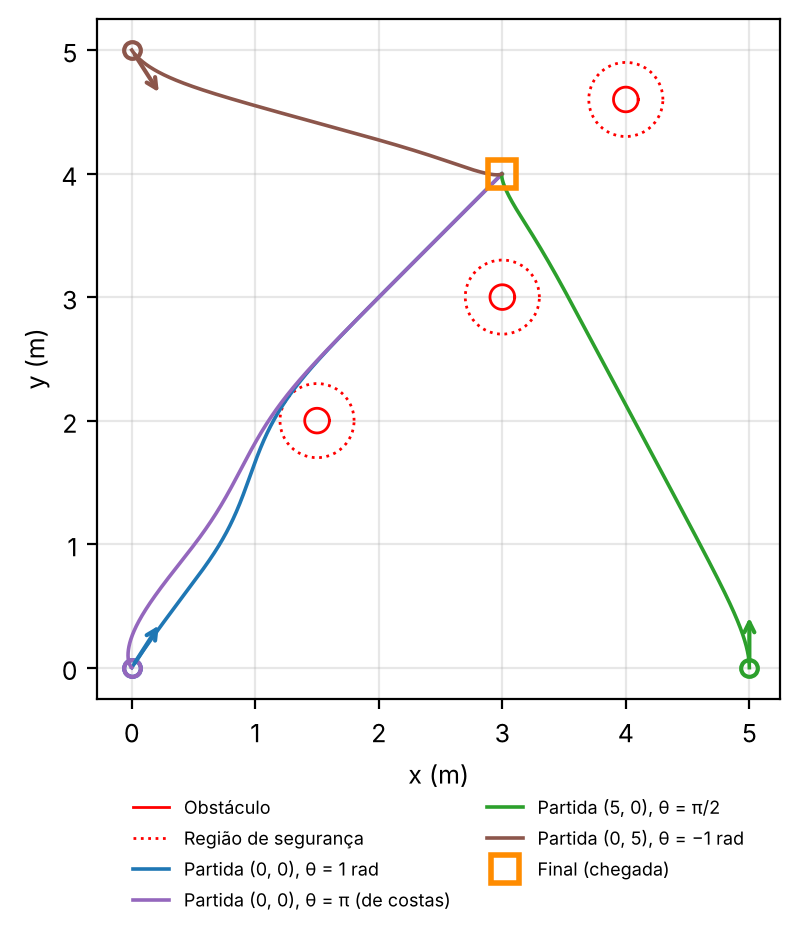

# 8. Cenários de simulação

Três cenários, cada um com um modelo Simulink, um arquivo de inicialização (`INIT`) e uma configuração equivalente no pacote Python.

| | Circular | Reta | Ponto de chegada |
|---|---|---|---|
| **Pasta MATLAB** | [`matlab/circular`](../matlab/circular) | [`matlab/reta`](../matlab/reta) | [`matlab/ponto`](../matlab/ponto) |
| **Modelo** | `SIMU_DIF_CBF_v2_refcirc.slx` | `SIMU_DIF_CBF_reta_refdef.slx` | `SIMU_DIF_CBF_ponto_sensor.slx` |
| **Inicialização** | `INIT_DIF_CBF_circular.m` | `INIT_DIF_CBF_reta_refdef.m` | `INIT_DIF_CBF_ponto_sensor.m` |
| **Python** | `scenarios.run_circular` | `scenarios.run_line` | `scenarios.run_goal` |
| **Referência** | círculo $R = 2$ m, centro na origem, $\omega = 0{,}25$ rad/s | reta de $(0,0)$ a $(6,6)$ em 60 s | ponto $(5,5)$, orientação final $\pi/4$ |
| **Pose inicial** $(x_0, y_0, \theta_0)$ | $(1, 0, 0)$ | $(0, 0, 1)$ | $(0, 0, 0)$ |
| **Obstáculos** (`xo`, `yo`) | $(-1,-1{,}5)$, $(0, 2{,}2)$, $(1{,}75,-1)$, $(-2, 0{,}8)$ | $(2,2)$, $(4{,}2;\,4{,}4)$, $(3{,}4;\,3{,}2)$ | $(1{,}67;\,1{,}25)$, $(2{,}3;\,2{,}6)$, $(4{,}23;\,4{,}25)$ |
| **Nominal** | Kanayama $(4, 4, 6)$ | Kanayama $(2, 10, 3)$ | polar $(0{,}8;\,2;\,-0{,}5)$, giro final a 5 mm |
| **$psc$ / $c$ / $\lambda$** | 1000 / 0,3 / 10 | 100 / 0,3 / 10 | 100 / 0,3 / 10 |
| **Deformação** | $m = 0{,}05$; $p_w = 0{,}7$ rad; $t_{olo} = 0$ | $m = 0{,}05$; $p_w = 0{,}8$ m | $m = 0{,}05$; $p_w = 1{,}2$ m; $L_d = 0{,}6$ m; sensor 3 m |
| **Comum** | $l = 0{,}2$ m; $r_s = 0{,}3$ m; $|v|,|w| \le 2$; $T_s = 0{,}01$ s; 200 iterações no QPhild | | |

## 8.1 Circular

Seguimento do círculo, com quatro obstáculos espalhados. Os obstáculos dentro do círculo (ou sobre ele) são contornados por fora; os de fora, por dentro ([07](07-referencia-deformada.md)). O robô parte de $(1, 0)$ e a referência de $(2, 0)$: há um transitório inicial.

## 8.2 Reta

Reta percorrida a 0,14 m/s, com um obstáculo sobre ela e dois a cerca de 0,14 m, um de cada lado. O robô passa pela direita do primeiro, pela esquerda do segundo e pela direita do terceiro, e volta à reta entre eles.

## 8.3 Ponto de chegada

O robô parte da pose do `INIT` (posição e sentido) e busca o ponto final **sem trajetória definida**, recalculando o alvo a cada instante. Chega com a orientação final desejada, girando no lugar nos últimos 5 mm.

## 8.4 Como os sinais do Simulink são gravados

O bloco devolve `out = [x'; y'; theta'; v; w; h; xd0; yd0; thetad0]`; o modelo integra as três primeiras componentes e grava no workspace `t, x, y, theta, v, w, h, xd, yd, thetad`. As referências gravadas são as **originais** (círculo, reta ou ponto de chegada), não a deformada.
