# 11. Resultados

Os números abaixo são de [`results/metricas.json`](../results/metricas.json) (réplica Python). As capturas do Simulink ficam em [`figures/simulink`](../figures/simulink).

## 11.1 Círculo

| Configuração (4 obstáculos, $r_s = 0{,}3$ m) | Distância ao círculo (rms / máx.) | $h$ mínimo |
|---|---|---|
| Lado fixo (viés de lado) | 0,182 / 0,640 m | 0,000 |
| Tolerância $t_{olo} = 0{,}1$ m | 0,134 / 0,368 m | n/d |
| **Referência deformada ($t_{olo} = 0$)** | **0,126 / 0,333 m** | 0,030 |

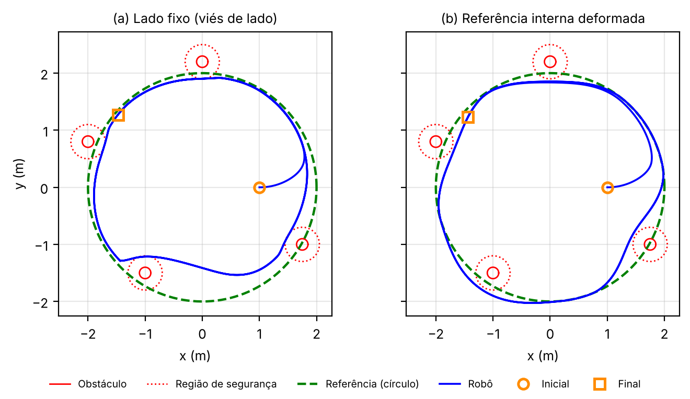

Tolerância da regra de lado, no Simulink (esquerda: 0,1 m; direita: 0):

| | |
|---|---|
| 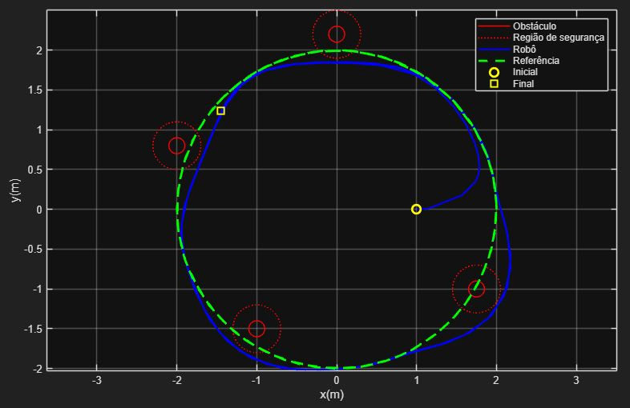 | 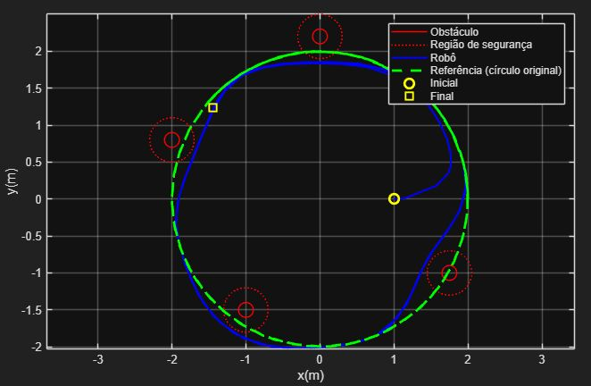 |

Sinais do Simulink (círculo, tolerância 0): $v$ ≈ 0,5 m/s, $w$ suave entre −0,2 e 0,6 rad/s fora do transitório inicial, e $h \ge 0$.

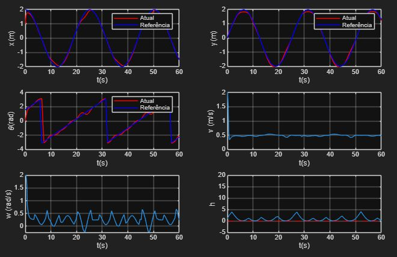

Efeito do $psc$ e experimentos adicionais: [04](04-qp-e-solver.md) e [12](12-historico-de-melhorias.md).

## 11.2 Reta

| Cenário (Python) | Método | Distância à reta (rms / máx.) |
|---|---|---|
| A: $(2,2)$, $(4,4{,}4)$, $(4,3)$ | viés de lado | 0,097 / 0,377 m |
| A | **referência deformada** | **0,095 / 0,350 m** |
| B: $(2,2)$, $(4,4)$ | viés de lado | 0,136 / 0,377 m |
| B | **referência deformada** | **0,132 / 0,351 m** |

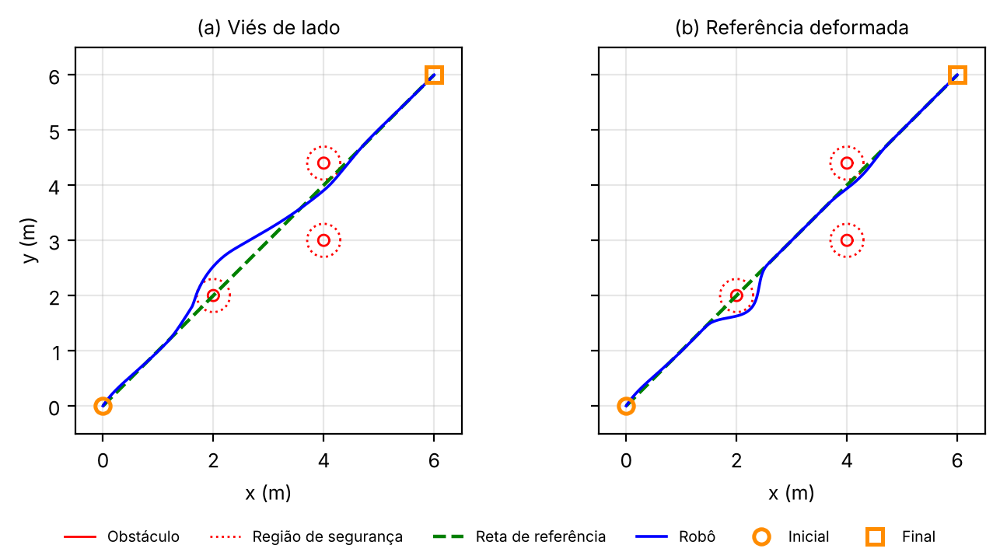

No Simulink (obstáculos do `INIT_DIF_CBF_reta_refdef.m`): o robô passa pela direita do obstáculo sobre a reta, pela esquerda do segundo e pela direita do terceiro; $v$ fica entre 0,14 e 0,17 m/s, $w$ entre −0,4 e 0,4 rad/s, e $h$ nunca fica negativo.

| | |
|---|---|
| 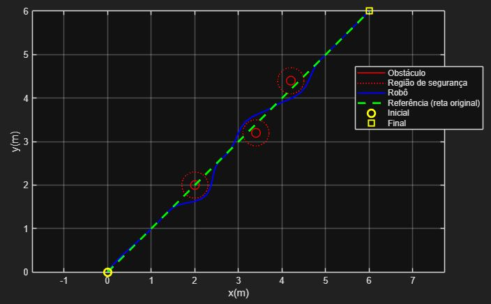 | 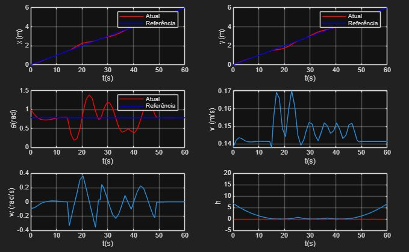 |

## 11.3 Ponto de chegada

Ponto (3, 4), orientação final $\pi/4$, quatro poses iniciais (Python):

| Pose inicial | Erro de posição (cm) | Erro de orientação (rad) | Saltos de $w$ | $h$ mínimo |
|---|---|---|---|---|
| $(0,0)$, $\theta = 1$ | 0,49 | 0,0000 | 0 | 0,006 |
| $(0,0)$, $\theta = \pi$ (de costas) | 0,50 | 0,0000 | 0 | 0,016 |
| $(5,0)$, $\theta = \pi/2$ | 0,49 | 0,0000 | 0 | 0,129 |
| $(0,5)$, $\theta = -1$ | 0,49 | 0,0000 | 0 | 0,832 |

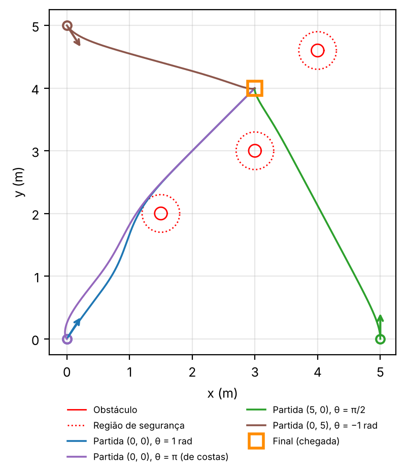

Cenário do `INIT_DIF_CBF_ponto_sensor.m` (alvo $(5,5)$, pose $(0,0,0)$): erro final de 0,49 cm e 0,0000 rad (Python). No Simulink, a chegada ocorre em cerca de 18 s, a velocidade fica em torno de 0,5 m/s e depois cai a zero, a orientação converge para $\pi/4$ e $h \ge 0$:

| | |
|---|---|
| 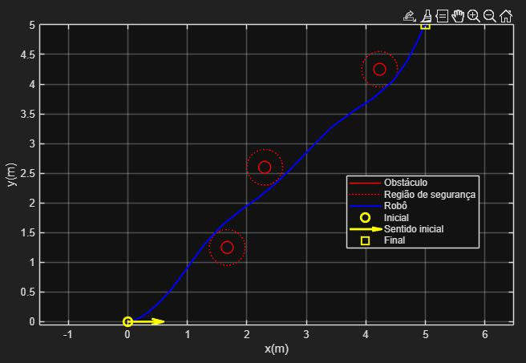 | 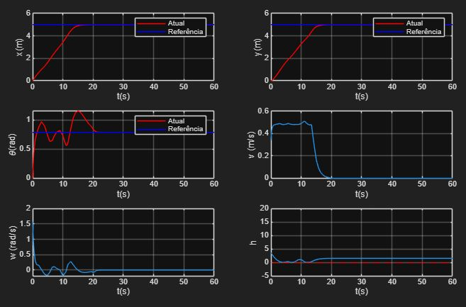 |

Segundo ponto de chegada testado no Simulink, $(6, 4)$ (o `INIT` correspondente não está neste repositório; as posições dos obstáculos, estimadas da figura, são ≈ $(1{,}5;\,1{,}1)$, $(3{,}5;\,2)$, $(5;\,3{,}5)$):

| | |
|---|---|
| 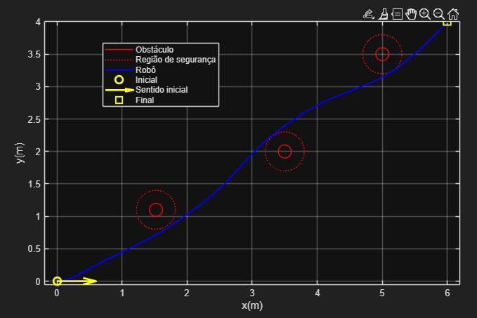 | 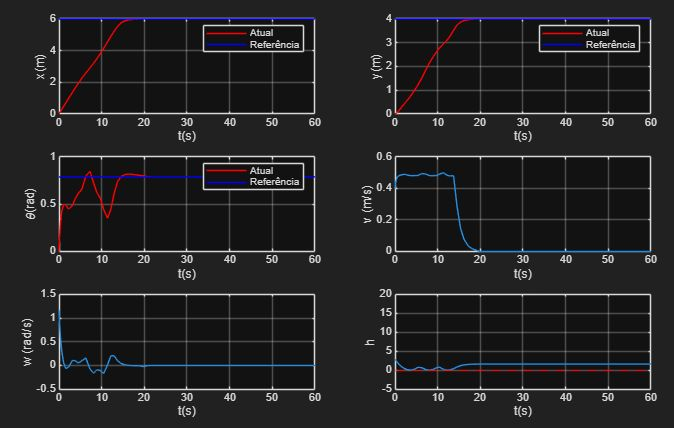 |

## 11.4 Resumo

| Cenário | Segurança ($h$) | Rastreamento | Observação |
|---|---|---|---|
| Círculo | $h \ge 0$ | afastamento máx. 0,33 m do círculo | o desvio é o necessário para a folga $r_s + m$ |
| Reta | $h \ge 0$ | afastamento máx. 0,35 m | lado determinístico |
| Ponto | $h \ge 0$ | erro final 0,5 cm / 0,00 rad | independe da pose inicial |

> Valores lidos nas capturas do Simulink (tempo de chegada, faixas de $v$ e $w$) são aproximados.
